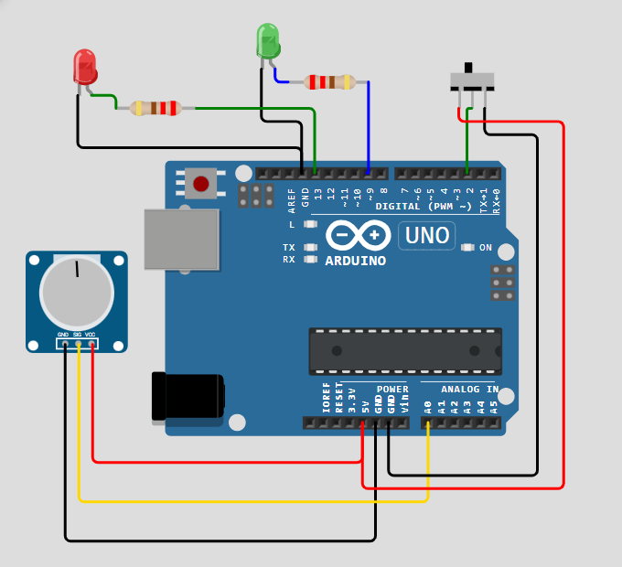
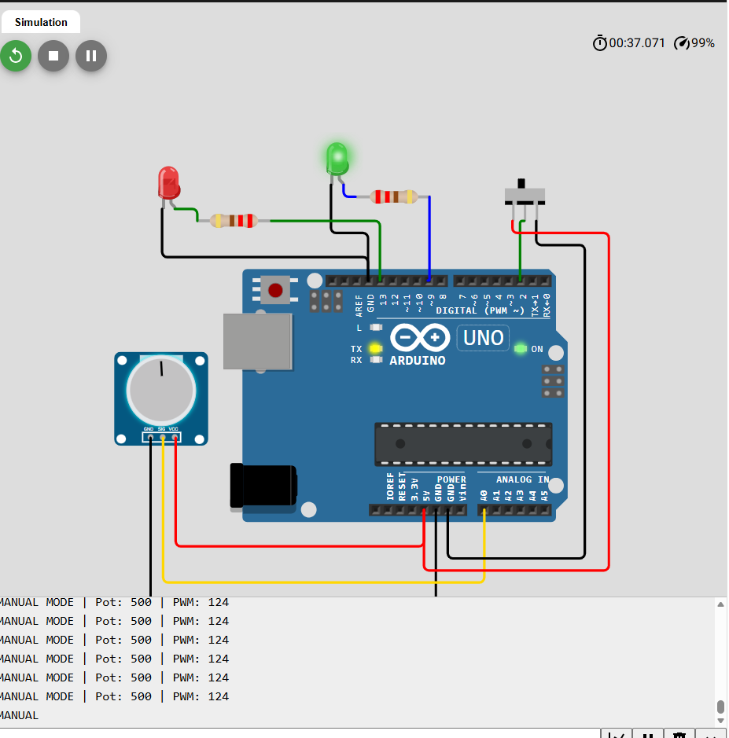
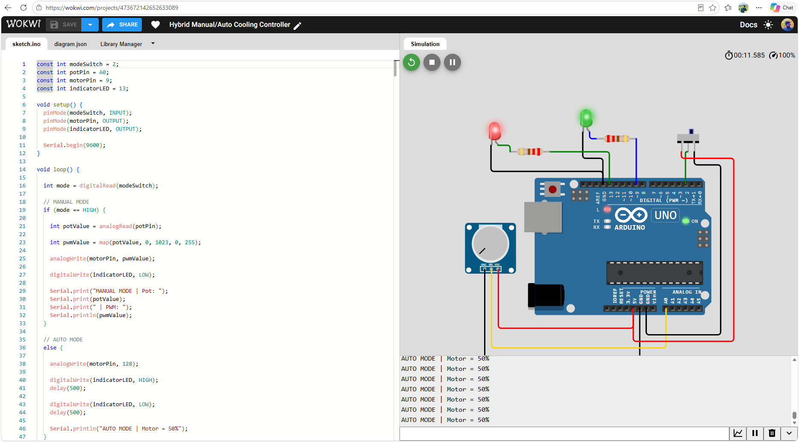

<div align="center">

# HYBRID MANUAL / AUTO COOLING CONTROLLER

### Arduino UNO • PWM • Potentiometer • Slide Switch • Wokwi Simulation

[](https://www.arduino.cc/)
[](https://wokwi.com/projects/473672142652633089)
[](LICENSE)

**[▶ Open the original Wokwi simulation](https://wokwi.com/projects/473672142652633089)**

</div>

## Project overview
This Arduino UNO project demonstrates a two-mode cooling-control **logic simulation**. In **manual mode**, the potentiometer sets a PWM output from 0 to 255. In **automatic mode**, PWM is held at 128 (approximately 50% duty cycle), and the red status LED blinks every 500 ms. The Serial Monitor reports the current mode and values.

> **Important:** The green LED in the provided simulation represents the PWM/motor command. No physical motor, motor driver, temperature sensor, or temperature-based feedback controller is included. The automatic mode is a **fixed PWM setting**, not temperature-regulated automatic cooling.

## Simulation screenshots

### Complete circuit


### Manual mode


### Automatic mode and source code


## Components
| Component | Quantity | Purpose |
|---|---:|---|
| Arduino UNO | 1 | Controller |
| Potentiometer | 1 | Manual speed command |
| 3-pin slide switch | 1 | Manual/auto mode selector |
| Green LED | 1 | Visual PWM output indicator (motor proxy) |
| Red LED | 1 | Automatic mode blinking indicator |
| 220 Ω resistors | 2 | LED current limiting |

## Pin connections
| Arduino pin | Connection | Role |
|---|---|---|
| D2 | Slide switch center terminal | Mode input |
| A0 | Potentiometer signal | Manual input |
| D9 (PWM) | Green LED through 220 Ω resistor | PWM output proxy |
| D13 | Red LED through 220 Ω resistor | Auto-mode indicator |
| 5V / GND | Potentiometer and outer slide-switch terminals | Supply and defined logic levels |

Connect each LED cathode to GND. The slide switch connects D2 to either 5V or GND; this makes `INPUT` safe without an internal pull-up. **Do not leave the mode input floating.**

## How it works
1. **Manual mode (D2 = HIGH):** Read the potentiometer (0–1023), map to PWM (0–255), output on D9; red LED remains off.
2. **Auto mode (D2 = LOW):** Set D9 PWM to 128 (~50%); blink red LED at 500 ms ON / 500 ms OFF.
3. **Serial Monitor:** Open at **9600 baud** to view live mode and PWM values.

Example serial output:
```text
MANUAL MODE | Pot: 500 | PWM: 124
AUTO MODE | Motor = 50%
```

## Run in Wokwi
1. Open the [original Wokwi project](https://wokwi.com/projects/473672142652633089) or create a new Arduino UNO project.
2. Copy the root `sketch.ino` and `diagram.json` into the corresponding Wokwi editor tabs.
3. Start simulation, toggle the slide switch, and rotate the potentiometer in manual mode.
4. Open the Serial Monitor (9600 baud) to inspect values.

The included `diagram.json` is a **reconstructed editable circuit** from the provided screenshots, not an export of the original Wokwi project. Verify its wiring and visual layout after importing. The original project link is the reference for the exact online simulation.

## Repository layout
```text
Hybrid-Manual-Auto-Cooling-Controller/
├── README.md
├── sketch.ino
├── diagram.json
├── libraries.txt
├── wokwi.toml
├── src/
│   └── Hybrid_Manual_Auto_Cooling_Controller.ino
├── docs/
│   ├── CONNECTIONS.md
│   └── images/
│       ├── wiring-overview.png
│       ├── wokwi-manual-mode.png
│       └── wokwi-code-and-auto-mode.png
├── .gitignore
└── LICENSE
```

## Limitations and next steps
- The project demonstrates manual PWM control and fixed-duty automatic operation; it does not measure temperature.
- For a **real fan**, use a properly rated motor driver or MOSFET stage, appropriate power supply, flyback protection for inductive loads, and common ground where applicable. Never drive a motor directly from an Arduino I/O pin.
- Potential extension: add a temperature sensor and closed-loop fan control.

## License
MIT License. See [LICENSE](LICENSE).
